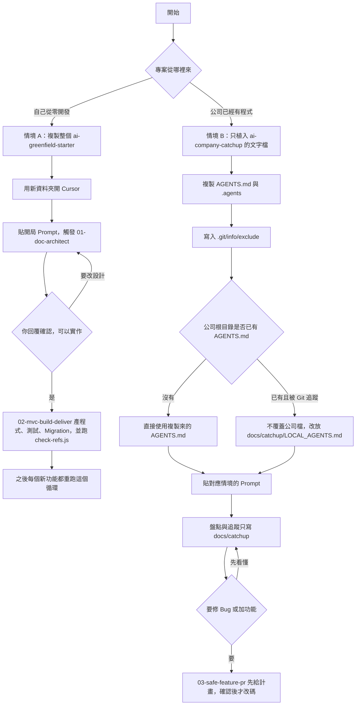

# AI Agent 開發規範庫使用手冊

這個資料夾是兩套可複製的 AI 工作規範，不是一個會啟動的應用程式。一次只帶一套去用。

| | `ai-greenfield-starter/` | `ai-company-catchup/` |
| --- | --- | --- |
| 使用時機 | 自己從零開一個新專案 | 進公司接手已經存在的舊專案 |
| 你複製什麼 | 整個資料夾，它就是新專案的根目錄 | 只複製 `AGENTS.md` 與 `.agents/` |
| 會不會改對方的架構 | 會。新專案從第一天就用 MVC、Doc-Driven、`#REF` | 不會。沿用公司既有目錄、命名與框架 |
| 筆記與規範進不進 Git | 進。這份新專案的文件與程式一起提交 | 不進公司遠端。用 `.git/info/exclude` 留在本機 |
| 改程式的閘門 | 你回覆「確認，可以實作」 | 你回覆「確認，可以改」 |
| 第一個 Skill | `01-doc-architect` | `01-repo-onboarding` |



下面的路徑以這台電腦的預設位置為例：

```text
C:\Users\user\Desktop\ai-dev-libraries
```

若規範庫不在這個路徑，只替換指令裡的來源路徑。

---

## 情境 A：從零開新專案

用 `ai-greenfield-starter/`。新專案會強制文件先行：先寫 `docs/`，你確認後才改 `src/`。

### Step 1：複製與初始化

把來源整個複製到一個新的空目錄。目標目錄請先不存在，避免把檔案混進別的專案。

Windows PowerShell：

```powershell
$src = "C:\Users\user\Desktop\ai-dev-libraries\ai-greenfield-starter"
$dst = "C:\Users\user\Desktop\my-new-app"
Copy-Item -Path $src -Destination $dst -Recurse
Set-Location $dst
git init -b main
node scripts/check-refs.js
```

Mac / Linux：

```bash
src="$HOME/Desktop/ai-dev-libraries/ai-greenfield-starter"
dst="$HOME/Desktop/my-new-app"
cp -R "$src" "$dst"
cd "$dst"
git init -b main
node scripts/check-refs.js
```

`node scripts/check-refs.js` 結束碼應為 0，並印出掃描檔案數與連結數。這一支腳本只掃描 `docs/` 與 `src/`。

接著用 Cursor 開啟 `$dst` 那個新資料夾，不要開 `ai-dev-libraries` 本身。

新專案第一天還有兩件要補，否則 `.github/workflows/ci.yml` 的 Lint 與 Unit test 會失敗：

- 在 `package.json` 提供 `scripts.lint` 與 `scripts.test`。測試失敗時指令必須回傳非 0。
- 把 `docs/00-architecture.md` 裡的 `<PROJECT_NAME>` 改成真實專案名稱。這件事交給 Step 2 的設計文件一起做。

`Check #REF links` 這個 job 不需要 `package.json`，現在就能過。

### Step 2：啟動設計階段

在新專案的 Cursor 對話貼上下面整段。尖括號改成你的技術棧與需求後再送出。

```text
請先讀 AGENTS.md 與 docs/00-architecture.md。
本專案技術棧：Node.js 20、TypeScript、Express、PostgreSQL。測試用 node:test。
請依照 .agents/skills/01-doc-architect/SKILL.md 處理這個需求：<用三句話寫使用者做得到什麼、輸入是什麼、失敗時要怎樣>。
請把 <PROJECT_NAME> 寫進 docs/00-architecture.md，為每個 Model、Controller、Service、View 建立 1:1 的 docs 設計文件，並寫上雙向 #REF。
我回覆「確認，可以實作」之前，不要修改 src/、tests/、db/migrations/、.env.example。
寫完後執行 node scripts/check-refs.js，把結果與「請確認設計文件」區塊一起給我。
```

這一輪結束時，你應該看到設計文件路徑、影響範圍、Migration 檔名或「無」、環境變數或「無」，以及一句「尚未修改 src/」。

### Step 3：通關密語確認

只有下面三句會放行實作：

- `確認，可以實作`
- `同意這個設計`
- `按文件做`

`好`、`繼續`、`嗯`、`你看著辦` 不會放行。代理會再問一次。

你接受後，貼：

```text
確認，可以實作。
請依照 .agents/skills/02-mvc-build-deliver/SKILL.md，只實作已確認的設計文件列出的路徑。
```

`02-mvc-build-deliver` 會依設計文件產出或更新這些位置：

| 位置 | 內容 |
| --- | --- |
| `docs/<layer>/<Name>.md` | 設計階段已寫好的文件；施工時若介面有差，會先改文件再停下來等你重新確認 |
| `docs/00-architecture.md` | 映射表補上新類別 |
| `src/models/`、`src/controllers/`、`src/services/`、`src/views/` | 對應類別。每個類別宣告前有 `#REF` 註解 |
| `tests/<layer>/<Name>.test.*` | 成功路徑、不變量被拒絕、Controller 只轉發 |
| `db/migrations/YYYYMMDDHHMMSS_<snake_name>.sql` | 只有設計文件寫了結構變更才會產生 |
| `.env.example` | 只有設計文件新增了環境變數才會補假值 |

施工結束前會在專案根目錄執行：

```bash
node scripts/check-refs.js
```

通過才輸出 Conventional Commit 與 PR 描述。你沒有在同一句話裡要求提交時，它不會執行 `git commit` 或 `git push`。

### Step 4：日常開發與新增功能循環

每一個新功能或會改行為的重構都重跑 Step 2 與 Step 3。把需求換成這一次要做的事：

```text
請依照 .agents/skills/01-doc-architect/SKILL.md 新增功能：<功能名稱>。
先更新 docs/ 的設計文件與 docs/00-architecture.md 的映射表，補上雙向 #REF。
我回覆「確認，可以實作」之前，不要改 src/。
```

確認後：

```text
確認，可以實作。
請依照 .agents/skills/02-mvc-build-deliver/SKILL.md 實作，並執行 node scripts/check-refs.js。
```

只改註解錯字、不改變行為時，可以直說「這次只改註解，不要改設計文件」，並要求它在回報裡寫明原因。

功能做完、你要留版本時再自己提交，或明確告訴代理可以 commit。提交前看 `git status`，確認沒有 `.env`。

---

## 情境 B：進公司接手現有專案

用 `ai-company-catchup/`。規範與筆記留在你的電腦，公司 `git status` 不該看到它們。公司原本的寫法優先，不要把專案改成情境 A 的 MVC 骨架。

以下指令都在公司專案的根目錄執行。來源路徑維持這套武器庫的位置。

### Step 1：無痛植入與防污染設定

先看公司有沒有自己的 `AGENTS.md`，以及它有沒有被 Git 追蹤。

```powershell
git ls-files --error-unmatch AGENTS.md
```

```bash
git ls-files --error-unmatch AGENTS.md
```

結束碼 1 且訊息是路徑不符合，代表公司沒有追蹤這個檔，走「直接植入」。結束碼 0 代表公司已經追蹤它，走「安全合併」。

#### 直接植入

公司根目錄沒有 `AGENTS.md`，或有這個檔但尚未被追蹤，而且你確定可以把它留在本機。

Windows PowerShell：

```powershell
$lib = "C:\Users\user\Desktop\ai-dev-libraries\ai-company-catchup"
Copy-Item -Path (Join-Path $lib "AGENTS.md") -Destination ".\AGENTS.md"
Copy-Item -Path (Join-Path $lib ".agents") -Destination ".\.agents" -Recurse
New-Item -ItemType Directory -Force -Path ".\docs\catchup" | Out-Null
$exclude = ".\.git\info\exclude"
$marker = "# local AI catchup, do not commit"
if (-not (Test-Path $exclude)) { New-Item -ItemType File -Force -Path $exclude | Out-Null }
$raw = Get-Content -Raw -Path $exclude -ErrorAction SilentlyContinue
if ($raw -notmatch [regex]::Escape($marker)) {
@"

# local AI catchup, do not commit
/AGENTS.md
/.agents/
/docs/catchup/
"@ | Add-Content -Path $exclude -Encoding utf8
}
git check-ignore -v --no-index AGENTS.md .agents/skills/01-repo-onboarding/SKILL.md docs/catchup
git status --short
```

Mac / Linux：

```bash
lib="$HOME/Desktop/ai-dev-libraries/ai-company-catchup"
cp "$lib/AGENTS.md" ./AGENTS.md
cp -R "$lib/.agents" ./.agents
mkdir -p ./docs/catchup
exclude=".git/info/exclude"
marker="# local AI catchup, do not commit"
touch "$exclude"
if ! grep -qF "$marker" "$exclude"; then
  cat >> "$exclude" <<'EOF'

# local AI catchup, do not commit
/AGENTS.md
/.agents/
/docs/catchup/
EOF
fi
git check-ignore -v --no-index AGENTS.md .agents/skills/01-repo-onboarding/SKILL.md docs/catchup
git status --short
```

成功時，`git check-ignore` 三行都指向 `.git/info/exclude`，`git status --short` 沒有 `AGENTS.md`、`.agents/`、`docs/catchup/`。

不要把這三條規則寫進公司的 `.gitignore`。那個檔會被提交。

#### 若公司原本已有 `AGENTS.md`

被 Git 追蹤的 `AGENTS.md` 不要覆蓋，也不要把接手規則直接貼進去。那樣一改，`git status` 就會出現公司檔的修改。

安全作法是公司檔原封不動，接手憲法改放進已被排除的私人目錄。

Windows PowerShell：

```powershell
$lib = "C:\Users\user\Desktop\ai-dev-libraries\ai-company-catchup"
New-Item -ItemType Directory -Force -Path ".\docs\catchup" | Out-Null
Copy-Item -Path (Join-Path $lib "AGENTS.md") -Destination ".\docs\catchup\LOCAL_AGENTS.md"
if (Test-Path ".\.agents") {
  Copy-Item -Path (Join-Path $lib ".agents\skills\*") -Destination ".\.agents\skills\" -Recurse -Force
} else {
  Copy-Item -Path (Join-Path $lib ".agents") -Destination ".\.agents" -Recurse
}
$exclude = ".\.git\info\exclude"
$marker = "# local AI catchup, do not commit"
if (-not (Test-Path $exclude)) { New-Item -ItemType File -Force -Path $exclude | Out-Null }
$raw = Get-Content -Raw -Path $exclude -ErrorAction SilentlyContinue
if ($raw -notmatch [regex]::Escape($marker)) {
@"

# local AI catchup, do not commit
/docs/catchup/
/.agents/skills/01-repo-onboarding/
/.agents/skills/02-trace-and-doc/
/.agents/skills/03-safe-feature-pr/
"@ | Add-Content -Path $exclude -Encoding utf8
}
git check-ignore -v --no-index docs/catchup/LOCAL_AGENTS.md .agents/skills/01-repo-onboarding/SKILL.md
git status --short
git diff -- AGENTS.md
```

Mac / Linux：

```bash
lib="$HOME/Desktop/ai-dev-libraries/ai-company-catchup"
mkdir -p ./docs/catchup ./.agents/skills
cp "$lib/AGENTS.md" ./docs/catchup/LOCAL_AGENTS.md
cp -R "$lib/.agents/skills/." ./.agents/skills/
exclude=".git/info/exclude"
marker="# local AI catchup, do not commit"
touch "$exclude"
if ! grep -qF "$marker" "$exclude"; then
  cat >> "$exclude" <<'EOF'

# local AI catchup, do not commit
/docs/catchup/
/.agents/skills/01-repo-onboarding/
/.agents/skills/02-trace-and-doc/
/.agents/skills/03-safe-feature-pr/
EOF
fi
git check-ignore -v --no-index docs/catchup/LOCAL_AGENTS.md .agents/skills/01-repo-onboarding/SKILL.md
git status --short
git diff -- AGENTS.md
```

`git diff -- AGENTS.md` 應該沒有輸出。之後每一則 Prompt 的第一行改成：

```text
公司既有 AGENTS.md 優先。接手規則以 docs/catchup/LOCAL_AGENTS.md 為準。兩者衝突時聽從公司檔。
```

若 `.agents/skills/01-repo-onboarding` 這個名字公司已經有了，先停下來問人，不要覆蓋。

### Step 2：三大情境開箱即用 Prompt 庫

在公司專案的 Cursor 對話貼。一次只做一件事。

#### 剛拿到專案權限

觸發 `01-repo-onboarding`。這一輪只畫地圖與找地雷，不改程式。

```text
請依照 .agents/skills/01-repo-onboarding/SKILL.md 接手這個儲存庫。
只允許寫入 docs/catchup/。不要修改應用程式碼、設定、lockfile、CI，不要 commit，不要 push。
請掃描實際存在的設定檔，盤點技術棧與 CI/CD，找出行程入口與核心路由。
追蹤 1 到 2 條核心業務資料流，各畫一張 Mermaid 架構圖與一張循序圖。參與者使用程式裡的真實名稱。
寫出 docs/catchup/00-overview.md、docs/catchup/01-tech-stack.md、docs/catchup/02-risks.md，以及每條流程一份 flow 筆記。
地雷清單每一列都要有檔案路徑。看到密碼、API Key、Token 時只寫路徑與變數名稱，不要複製值。
```

#### 追蹤複雜祖傳程式碼

觸發 `02-trace-and-doc`。把尖括號換成你點開的檔案與符號。

```text
請依照 .agents/skills/02-trace-and-doc/SKILL.md，從 <檔案路徑> 的 <符號名稱> 往上與往下追。
在 docs/catchup/module-<english-slug>.md 寫私人筆記，使用 #REF: [相對路徑#錨點] - 關聯說明 與 docs/catchup/00-overview.md 互連。
往下記到資料庫、外部服務或純計算為止。往上記到路由、排程或訊息處理器。同名符號超過一個時先列出候選，不要全部展開。
不要修改公司程式，不要在公司程式裡補註解，不要把秘密寫進筆記。
```

#### 修 Bug 或開發新功能

觸發 `03-safe-feature-pr`。先看到計畫，再決定要不要放行。

```text
請依照 .agents/skills/03-safe-feature-pr/SKILL.md 處理：<缺陷現象，或新功能的輸入與預期結果>。
先給修改計畫與影響範圍，並寫明你要模仿的既有檔案。
我回覆「確認，可以改」之前，不要修改程式。
確認後只改計畫裡的路徑，模仿周邊程式碼風格，補上同樣目錄與命名的測試，最後給 PR 描述。
PR 描述要包含變更摘要、影響評估、測試步驟。不要 commit，除非我另外要求。
```

放行時只貼：

```text
確認，可以改
```

同樣有效的另一句是 `按這個計畫改`。`好` 與 `繼續` 不會放行。

---

## 日常維護與升級指南

學到新規則，或 AI 又踩了同一次坑，就改對應的那一個檔，然後用一次真實任務試跑。不要同時改兩套庫來「保持對稱」，除非那個坑兩邊都會發生。

| 你要升級的行為 | 改這個檔 |
| --- | --- |
| 從零專案的語言、文件閘門、MVC、`#REF`、日誌、Commit、PR | `ai-greenfield-starter/AGENTS.md` |
| 設計文件要多寫哪一節、確認前禁止碰哪些路徑 | `ai-greenfield-starter/.agents/skills/01-doc-architect/SKILL.md` |
| 施工順序、測試要斷言什麼、交付報告欄位 | `ai-greenfield-starter/.agents/skills/02-mvc-build-deliver/SKILL.md` |
| 新專案的分層圖、例外表、環境變數表 | `ai-greenfield-starter/docs/00-architecture.md` |
| 斷鏈怎樣算失敗 | `ai-greenfield-starter/scripts/check-refs.js` |
| CI 要多一個 job，或換成別的語言的 lint/test | `ai-greenfield-starter/.github/workflows/ci.yml` |
| 可提交的環境變數名稱範本 | `ai-greenfield-starter/.env.example` |
| 接手時不准做的事、秘密與 Git 底線 | `ai-company-catchup/AGENTS.md` |
| 唯讀盤點要看哪些設定、筆記長什麼樣 | `ai-company-catchup/.agents/skills/01-repo-onboarding/SKILL.md` |
| 呼叫鏈要追到哪、`#REF` 怎麼寫進私人筆記 | `ai-company-catchup/.agents/skills/02-trace-and-doc/SKILL.md` |
| 修改計畫欄位、確認關鍵字、PR 描述 | `ai-company-catchup/.agents/skills/03-safe-feature-pr/SKILL.md` |
| 複製指令、exclude、開箱 Prompt | `ai-company-catchup/SETUP_GUIDE.md` 與本檔 `README.md` |

改完 Greenfield 的 `docs/` 或 `src/` 之後，在 `ai-greenfield-starter` 執行：

```bash
node scripts/check-refs.js
```

結束碼不是 0 就先修連結，再提交武器庫。改 Skill 或 `AGENTS.md` 時，用一則新對話貼對應的 Prompt，確認代理仍會停下來等你。

公司專案裡的副本不會自動更新。武器庫改完後，對該公司專案再執行一次情境 B 的複製指令。`Copy-Item -Force` 會蓋掉你在公司本機改過的同一份 Skill。公司 `docs/catchup/` 裡的筆記不要重拷，那些是你的閱讀紀錄。

---

## 常見問題排解

### AI 忘記遵守規則怎麼辦

1. 新開一個對話。長對話裡的舊結論常常蓋過規範。
2. 第一則訊息就寫出 Skill 的路徑，例如 `.agents/skills/01-doc-architect/SKILL.md`，並寫「請先讀 AGENTS.md」。
3. 在 Cursor 用 `@AGENTS.md` 把規範掛進這一次對話。
4. 它若已經改了 `src/` 而你還沒說確認關鍵字，回這句：

```text
停。還原你剛剛對 src/ 的修改。回到 .agents/skills/01-doc-architect/SKILL.md，先完成設計文件。我還沒說「確認，可以實作」。
```

5. 同一條規則連兩次都沒守住時，把該步驟寫進上表對應的 `SKILL.md`，用更短的禁止句放在該檔最上方的步驟裡，例如「同一輪禁止修改 src/」。

### `check-refs.js` 報錯怎麼修

在 `ai-greenfield-starter` 或你的新專案根目錄執行：

```bash
node scripts/check-refs.js
```

失敗時每一行是 `檔案:行號` 加原因。對著原因改，改完再跑，直到結束碼為 0。

| 訊息 | 原因 | 怎麼修 |
| --- | --- | --- |
| 目標檔案不存在 | `[...]` 裡的相對路徑從「寫下這一行的檔案所在目錄」算出去，找不到檔 | 修正路徑，或先建立目標檔與標題再寫 `#REF` |
| 找不到章節錨點 | 檔案在，但 `#` 後面的 id 對不到標題 | 在目標標題行尾加上 `{#那個id}`，或把 `#REF` 改成標題上已有的 id |
| 路徑超出儲存庫根目錄 | `..` 爬出專案根 | 改成專案內的相對路徑 |
| 禁止使用絕對路徑或 URL | 寫了 `C:\...` 或 `https://...` | 改成相對路徑 |
| 檔名大小寫不一致 | 路徑的大小寫和磁碟上的檔名不同 | 把 `#REF` 改成錯誤訊息裡「實際是」的那個名字 |
| 找不到掃描目錄 docs/ 或 src/ | 這兩個目錄被刪掉或沒有複製完整 | 從 `ai-greenfield-starter` 把缺的目錄補回來 |

`#REF` 寫在 `AGENTS.md` 或 `.agents/` 時，這支腳本不會掃到。`docs/` 與 `src/` 裡的程式碼區塊也算，所以範例連結也必須指向真的檔案。

同一檔案的章節可以寫成 `[#anchor-id]`，檔案部分留空。那是指這一行所在的檔，不是指 `docs/00-architecture.md`。

### Windows 與 Linux 路徑大小寫

Windows 預設不區分 `Order.md` 與 `order.md`，Linux 的 CI 會區分。`check-refs.js` 用目錄清單比對實際檔名字母，所以在 Windows 上也會把大小寫不同判成斷鏈。

請讓 `#REF`、檔名、`{#anchor-id}` 三者的大小寫完全一致。錨點用英文小寫與連字號，例如 `{#system-boundary}`。不要在 Windows 上只改大小寫來重新命名；Git 可能看不出差異。要改時分兩步提交：先改成暫時名稱，再改成正確名稱。
