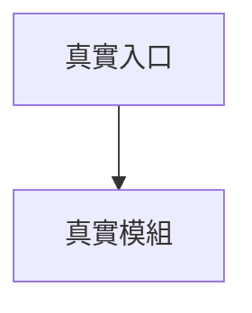
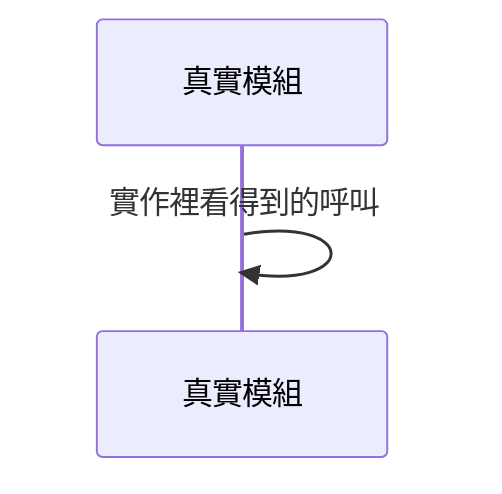

# 接手盤點

## 何時使用 {#when}

剛進入公司專案、使用者要求看懂儲存庫、或任何尚未被允許修改程式的探索。本 Skill 結束時，應用程式碼、設定、lockfile、CI 與公司文件都維持原狀。

#REF: [../../../AGENTS.md#do-no-harm] - 不重構、不搬目錄、不套用外部架構
#REF: [../../../SETUP_GUIDE.md#exclude] - 筆記目錄必須已在本機忽略清單

## 唯讀邊界 {#read-only}

允許：

- 讀檔、搜尋、列出目錄、讀 Git 歷史。
- 建立與更新 `docs/catchup/` 裡的 Markdown。

禁止：

- 修改、格式化、移動、刪除應用程式碼與公司文件。
- `git commit`、`git push`、改 Git 設定。
- 執行會寫入專案檔的安裝、資料庫 Migration、seed、程式產生器。
- 把秘密的值寫進筆記或回覆。

盤點階段不跑會產生快取或覆蓋檔案的指令。測試留到使用者確認要修 Bug 或做功能時再跑。

## 步驟 {#sop}

### 1. 盤點技術棧與 CI/CD

從儲存庫根目錄找出實際存在的設定，記錄路徑與版本宣告。沒有的項目寫「無」，不要假設。

依序查看：

- 語言與套件：`package.json`、`pnpm-lock.yaml`、`yarn.lock`、`pyproject.toml`、`requirements.txt`、`Pipfile`、`go.mod`、`pom.xml`、`build.gradle`、`*.csproj`、`Gemfile`、`composer.json`、`Cargo.toml`
- 執行與容器：`Dockerfile`、`docker-compose.yml`、`compose.yaml`、`Makefile`、`Procfile`
- CI/CD：`.github/workflows/`、`.gitlab-ci.yml`、`Jenkinsfile`、`azure-pipelines.yml`、`bitbucket-pipelines.yml`、`.circleci/`
- 應用設定範本：`.env.example`、`appsettings*.json`、`config/` 內不含秘密值的範本
- 品質門檻：linter、formatter、測試指令。只從 CI 與說明文件抄指令名稱，盤點時不執行會改檔的指令

寫入 `docs/catchup/01-tech-stack.md`，使用下面表格：

```markdown
# 技術棧 {#stack}

| 項目 | 證據路徑 | 觀察 |
| --- | --- | --- |
| 語言與執行環境 | | |
| 框架 | | |
| 套件管理 | | |
| 資料庫 | | |
| 測試 | | |
| CI | | |
| 部署 | | |

## 本地如何啟動 {#run}

只記錄文件或腳本裡已經寫明的指令。文件沒寫就標成未記載，不要編一組安裝步驟。

## CI 門檻 {#ci}

每個 workflow 或 pipeline 的名稱、觸發條件、會擋下合併的 job。
```

### 2. 找出入口與核心路由

搜尋啟動檔與路由表，例如 `main`、`index`、`app`、`server`、`Program.cs`、`urls.py`、`routes`、`router`、`controller` 註冊處。記錄：

- 行程從哪一個檔案開始。
- 路由或訊息處理器的註冊位置。
- 哪些路徑是健康檢查、靜態檔、背景排程，哪些是業務。

健康檢查不算核心業務。核心路由選 README 點名的流程；README 沒寫時，選路由表上最前面兩條會讀寫業務資料的路徑，並在筆記寫明選擇理由。

### 3. 追蹤 1 到 2 條核心業務資料流

每條流程從入口追到持久化或外部服務，再追回回應。沿路記錄真實的函式或類別名稱、檔案路徑、以及這一步在做驗證、授權、交易、外部 I/O 的哪一種。

不要追第三條，除非使用者點名。追不動時寫下斷點檔案與你缺的執行條件，不要用猜測把箭頭接完。

每條流程各寫一份 `docs/catchup/flow-<english-slug>.md`：

~~~~markdown
# <流程名稱> {#flow}

選擇理由：

## 架構位置 {#map}



## 時序 {#sequence}



## 步驟 {#steps}

| 順序 | 檔案與符號 | 這一步做什麼 | 失敗時 |
| --- | --- | --- | --- |

## 關聯 {#refs}

#REF: [./00-overview.md#flows] - 回到導讀的流程索引
#REF: [相對路徑#符號或標題] - 這一步對應的程式或筆記
~~~~

Mermaid 的參與者使用程式裡的名稱。不要畫成通用的 Controller / Service 分層，除非這份程式本來就是那樣命名。

### 4. 寫導讀與地雷清單 {#outputs}

建立 `docs/catchup/00-overview.md`：

```markdown
# 接手導讀 {#overview}

一句話說明這個系統做什麼，以及這句話的證據檔案。

## 入口 {#entry}

## 流程索引 {#flows}

| 流程 | 筆記 | 入口 |
| --- | --- | --- |

## 不要假設的寫法 {#local-style}

列出目錄慣例、命名、錯誤處理、測試位置。之後修改要模仿這些，而不是另起架構。

## 關聯 {#refs}

#REF: [./01-tech-stack.md#stack] - 技術棧證據
#REF: [./02-risks.md#landmines] - 地雷與技術債
```

建立 `docs/catchup/02-risks.md`：

```markdown
# 技術債與地雷 {#landmines}

| 嚴重度 | 位置 | 現象 | 為什麼是地雷 | 現在不做的原因 |
| --- | --- | --- | --- | --- |
| high / medium / low | 檔案路徑 | | | 盤點階段不改程式 |

## 觀察範圍 {#scope}

本次讀過的入口、流程與設定。沒讀過的區域標成未盤點。
```

地雷包含：循環依賴、無人測試的付款或權限路徑、全域可變狀態、在請求途中呼叫外部服務且沒有逾時、註解與程式不符、被跳過的測試、把秘密提交進儲存庫、啟動時就連正式環境。每一列都要有看得到的檔案位置。沒有證據就不要列。

## 記錄在地寫法 {#local-style}

在 `docs/catchup/00-overview.md` 的「不要假設的寫法」記錄這份程式已經在用的目錄、命名、錯誤處理與測試位置。之後的功能與修 Bug 模仿這些寫法。

這一節只描述看得到的習慣，不評價它應不應該改成另一種架構。公司程式不是 MVC 時，不要在導讀裡補一層 Controller / Service。

## 秘密 {#secrets}

筆記與回覆只出現路徑和變數名稱。看到值時不要複述，也不要把它貼進 `docs/catchup/` 來「保存現場」。

## 完成條件

回覆使用者三個路徑：`docs/catchup/00-overview.md`、`docs/catchup/01-tech-stack.md`、`docs/catchup/02-risks.md`，加上每一條 `flow-*.md`。說明你沒有修改應用程式碼。地雷清單裡的項目維持未修。
