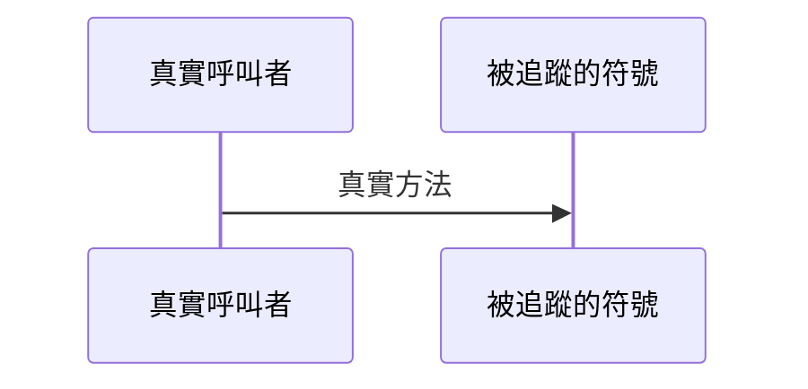

# 深度追蹤模組

## 何時使用 {#when}

使用者點名一個模組、類別、函式、路由或一條難懂的呼叫鏈，需要可以重讀的筆記。本 Skill 不修改應用程式碼。

尚未做過儲存庫盤點時，先確認 `docs/catchup/00-overview.md` 是否存在。不存在就先完成 `01-repo-onboarding`，再追這一個模組。使用者已經指定檔案時，不要為了做完整盤點而延後這一條追蹤。

#REF: [../../../AGENTS.md#notes] - 筆記只放在 docs/catchup/
#REF: [../01-repo-onboarding/SKILL.md#read-only] - 同樣禁止改應用程式碼與提交秘密

## 步驟 {#sop}

1. 鎖定起點。使用使用者給的符號與檔案。同名符號有多個時，列出候選路徑並先問要追哪一個，不要全部展開。
2. 往下追呼叫鏈，直到資料庫、外部服務、訊息佇列或純計算結束。記錄每一跳的檔案、符號、傳入什麼、回傳什麼。
3. 往上追誰呼叫它，停在路由、排程、訊息處理器或測試。呼叫者超過五個時，列出五個最接近業務入口的，並寫明還有多少個未展開。
4. 標出副作用：寫入、刪除、發信、付款、快取失效、交易的開始與提交。看不出交易邊界時寫「未看到交易邊界」，不要補一個理想架構。
5. 標出分支與錯誤處理：哪些例外被吃掉、哪些改寫成另一種錯誤、哪些會讓請求繼續。
6. 在 `docs/catchup/` 寫筆記，並在 `docs/catchup/00-overview.md` 的流程索引加一列指過來。總覽不存在時，本筆記仍可獨立建立，索引稍後補。
7. 每一條 `#REF` 都打開目標確認檔案存在。目標是 Markdown 時，確認章節錨點或標題存在。目標是程式時，錨點使用該檔裡真實出現的符號名稱。

相對路徑以筆記檔所在目錄計算。格式：

```text
#REF: [相對路徑#錨點] - 這條連結解釋什麼
```

程式檔沒有 Markdown 標題。錨點寫函式或類別名稱，例如 `src/billing/invoice.js#createInvoice`。筆記之間使用 `{#anchor-id}`。雙向是指：本筆記指向總覽與程式，總覽的索引指向本筆記；程式碼不回頭加註解，避免污染公司 Git。

## 筆記模板 {#note-template}

檔名：`docs/catchup/module-<english-slug>.md`

~~~~markdown
# <模組或符號名稱> {#module}

起點檔案：
追蹤日期所根據的程式版本：Git 短 SHA，或「工作區未提交變更」

## 這個模組做什麼 {#role}

用五句以內說明。每句後面用檔案路徑佐證。

## 呼叫鏈 {#chain}



| 方向 | 符號 | 路徑 | 備註 |
| --- | --- | --- | --- |
| up | | | |
| down | | | |

## 狀態與副作用 {#effects}

- 讀取：
- 寫入：
- 外部 I/O：
- 交易邊界：

## 容易看錯的地方 {#traps}

| 位置 | 表面上看起來 | 實際上 |
| --- | --- | --- |

## 關聯 {#refs}

#REF: [./00-overview.md#flows] - 回到接手導讀的流程索引
#REF: [相對程式路徑#符號] - 這段筆記描述的實作
~~~~

「容易看錯的地方」只記錄會讓後續修改改錯的行為，例如條件與名稱相反、失敗仍回傳成功、快取比資料庫舊。不要在這一節提出重構方案。若使用者接著要修，改走 `03-safe-feature-pr`，由那份 Skill 另寫修改計畫。

## 秘密 {#secrets}

沿路看到密碼、Token、連線字串或個資時，筆記只留檔案路徑與變數名稱。不複製值，不把設定檔貼進 Markdown。

## 完成條件

回覆筆記路徑、往上與往下各追到哪裡、以及你沒有改過的應用程式碼。呼叫鏈中間有斷點時，斷點要出現在回覆的第一段，不要只放在檔案底部。
