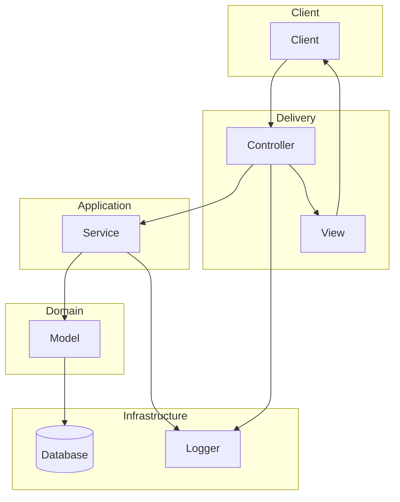
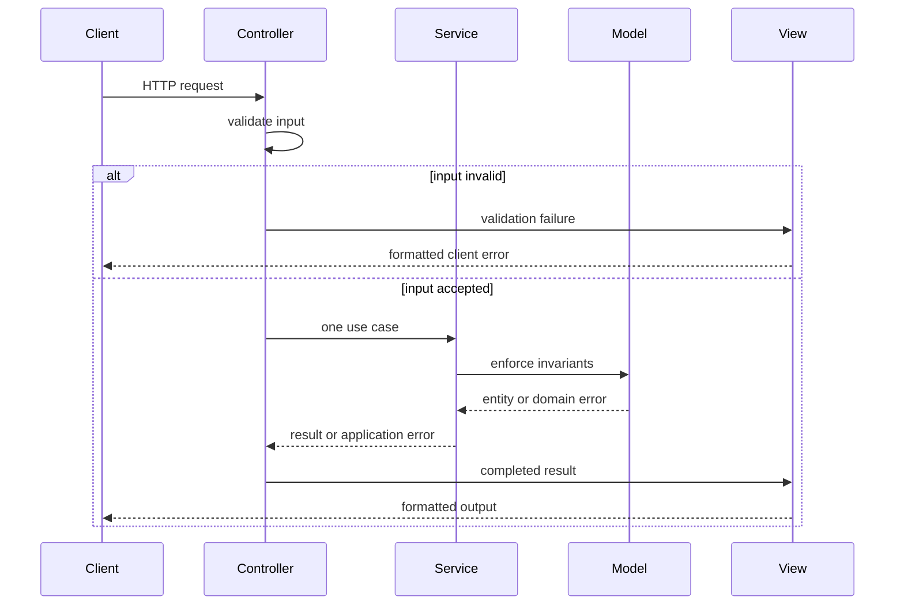

# 系統總覽 {#purpose}

專案名稱：`<PROJECT_NAME>`

本檔是新專案的架構契約。第一個功能開始前，把 `<PROJECT_NAME>` 換成真實名稱，並在「系統邊界」補上這個系統做什麼、不對誰提供服務。之後每一個 Model、Controller、Service、View 都在本檔的映射表加一列，並另寫 1:1 設計文件。

本檔是範本，也是會被 `scripts/check-refs.js` 檢查的正式文件。下面的 `#REF` 都指向已存在的檔案與章節。

#REF: [../AGENTS.md#doc-first] - 修改分層或新增模組前，必須先更新文件並得到確認

## 系統邊界 {#system-boundary}

`<PROJECT_NAME>` 是一個分層的伺服器端應用程式。外部客戶端只接觸 Controller 與 View。資料庫、環境變數與 Logger 是基礎設施，業務規則不散落在它們裡面。

邊界內：

- 接受外部請求，驗證輸入，執行一個使用案例，回傳格式化結果。
- 用 Model 保住資料不變量。
- 用 Service 保住交易邊界：失敗時不留下半套寫入。

邊界外：

- 不在本範本決定產品功能、部署平台與雲端供應商。那些決定寫進本節，不寫進程式常數。
- 不在程式裡寫死環境差異。執行期設定來自環境變數。

#REF: [00-architecture.md#layers] - 邊界內四層各自允許與禁止的職責
#REF: [../.env.example] - `APP_ENV`、`PORT`、`LOG_LEVEL`、`DB_URL` 的名稱範本

## 架構總覽 {#architecture-diagram}

靜態分層。箭頭是允許的依賴方向：外層依賴內層的契約，Model 不知道 HTTP。



#REF: [00-architecture.md#data-flow] - 同一條請求在執行時的順序

## 分層職責 {#layers}

| 層 | 職責 | 典型失敗 |
| --- | --- | --- |
| Controller | 解析請求、拒絕不合法輸入、呼叫一個 Service 方法、選擇 View | 在這裡計算金額或改狀態 |
| Service | 編排一個使用案例，開始與結束交易 | 直接讀取 HTTP header 或自行組回應文案 |
| Model | 資料形狀、不變量、核心驗證、參數化資料存取 | import 網頁框架或格式化 JSON |
| View | 把已完成的結果編成狀態碼與輸出格式 | 再查一次資料庫來決定業務結果 |

依賴由組合根在啟動時注入。業務類別的建構式接收契約，不在方法裡 `new` Logger 或資料庫連線。

#REF: [00-architecture.md#system-boundary] - 這些職責用來守住系統邊界
#REF: [00-architecture.md#mapping] - 每一層的類別檔與設計文件如何 1:1 放置
#REF: [../AGENTS.md#mvc-oop] - SOLID、封裝與 DI 的檢查方式

## 目錄與文件映射 {#mapping}

程式在 `src/`，設計文件在 `docs/`，檔名主體相同。

```text
src/models/<Name>.*              docs/models/<Name>.md
src/controllers/<Name>.*         docs/controllers/<Name>.md
src/services/<Name>.*            docs/services/<Name>.md
src/views/<Name>.*               docs/views/<Name>.md
db/migrations/<timestamp>_<name>.sql
tests/<layer>/<Name>.test.*
```

目前 `src/models/`、`src/controllers/`、`src/views/`、`src/services/` 只有 `.gitkeep`。尚無業務類別，所以還沒有 `docs/models/` 等檔案。新增類別時，同一變更必須同時有程式、設計文件、頂部 `#REF` 與單元測試。

映射表（有第一個模組後往下加，禁止只改程式不加列）：

| 類別 | 程式 | 設計文件 | 狀態 |
| --- | --- | --- | --- |
| 尚無 | — | — | 骨架已建立 |

#REF: [00-architecture.md#layers] - 映射所依據的分層職責
#REF: [00-architecture.md#ref-examples] - 映射建立之後連結怎麼互指

## 資料流 {#data-flow}

預設請求走這一段。新的使用案例若分岔，在該模組的設計文件另畫 sequence diagram，並用 `#REF` 指回本節。



步驟：

1. Controller 檢查型別、必填、長度、列舉與未知欄位。失敗直接交給 View，不進入 Service。
2. Controller 呼叫一個 Service 方法。
3. Service 開啟交易，呼叫 Model。Model 再檢查商業不變量。
4. Model 用參數化語句讀寫資料庫。
5. Service 在成功時提交，在失敗時回滾，把領域結果交回 Controller。
6. View 只編排輸出。客戶端看不到 stack、SQL 與環境變數。

#REF: [00-architecture.md#architecture-diagram] - 這段時序對應的靜態分層
#REF: [00-architecture.md#exceptions] - 上圖兩個失敗分支的錯誤型別與日誌等級

## 例外處理 {#exceptions}

| 情況 | 誰拋出 | 誰轉成回應 | 日誌 | 預設狀態碼 |
| --- | --- | --- | --- | --- |
| 輸入形狀不合法 | Controller 的驗證器 | View | `WARN` | 400 |
| 商業不變量不成立 | Model | Service 送回 Controller，View 編排 | `WARN` | 409 |
| 目標不存在 | Model | 同上 | `INFO` | 404 |
| 未處理例外、資料完整性破壞、外部依賴失敗 | 發生的那一層 | Controller 交給 View 一則通用訊息 | `ERROR` | 500 |

`ERROR` 日誌保留內部 stack 與 request id，供維運追查。回應正文只有錯誤類別與 request id。禁止把秘密寫進任一邊。

新的錯誤類別先寫進模組設計文件，再寫進程式。不要在 Controller 用狀態碼數字散落判斷業務。

#REF: [00-architecture.md#data-flow] - 例外發生在請求的哪一段
#REF: [../AGENTS.md#security-log-git] - Logger 只有 INFO、WARN、ERROR，回應不得含秘密

## 互連範例 {#ref-examples}

雙向連結用同一語法。本節指向映射與規範，映射與規範也指回本檔對應章節。

#REF: [../AGENTS.md#ref-standard] - 相對路徑、章節錨點與類別註解的完整規則
#REF: [../scripts/check-refs.js] - 掃描 `docs/` 與 `src/`，斷鏈時以結束碼 1 失敗
#REF: [00-architecture.md#mapping] - 連結的目標必須是映射裡真實存在的檔案

下面這段放在本檔，所以相對路徑指向本檔自己。日後註解寫在 `src/models/<Name>.*` 時，改以該檔目錄計算，通常要先回到專案根再進入 `docs/`。尚不存在的模組路徑不能寫進 `docs/` 或 `src/`，檢查器會判為斷鏈。

```javascript
// #REF: [00-architecture.md#layers] - 本總覽示範：類別註解與文件使用同一語法
class ExampleModel {
}
```

修改任一 `{#anchor-id}` 之前，先搜尋舊錨點，更新每一條 `#REF`，再執行：

```bash
node scripts/check-refs.js
```

通過時輸出掃描檔案數與連結數，結束碼為 0。失敗時逐條列出 `檔案:行號` 與原因，結束碼為 1。

## 環境與交付 {#delivery}

執行期至少讀取 `.env.example` 裡的四個名稱：

| 變數 | 用途 | 允許值 |
| --- | --- | --- |
| `APP_ENV` | 執行環境名稱 | `development`、`test`、`production` |
| `PORT` | 監聽埠 | 1 到 65535 的整數 |
| `LOG_LEVEL` | Logger 門檻 | `INFO`、`WARN`、`ERROR` |
| `DB_URL` | 資料庫連線 | 由環境注入，範本只放假值 |

CI 在 `.github/workflows/ci.yml`。Pull Request 必須同時通過三個 job：`Lint`、`Unit test`、`Check #REF links`。`scripts.lint` 與 `scripts.test` 要在失敗時回傳非 0。`scripts.test` 執行單元測試，不用一條永遠成功的指令代替。

資料庫結構變更另產生 `db/migrations/YYYYMMDDHHMMSS_<snake_name>.sql`，並在該功能的設計文件寫回滾方式。

#REF: [../.env.example] - 變數名稱的可提交範本，不含真實秘密
#REF: [../AGENTS.md#security-log-git] - Commit、PR 描述、秘密與日誌的交付格式
#REF: [../scripts/check-refs.js] - `check-refs` job 執行的同一支腳本
